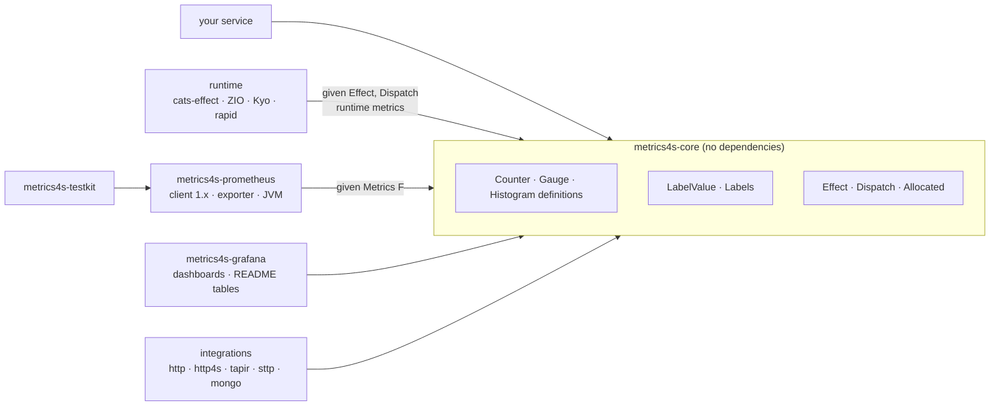

# Design notes

[← back to the README](README.md)

Why `metrics4s` is shaped the way it is. The README says what the API does. This page says what was chosen, what was
rejected and what each choice costs. Several decisions look arbitrary until you know the failure they answer, so the
failures are here too. What was decided and when is in [Decisions](#decisions).

* [Why another metrics library](#why-another-metrics-library)
* [Principles](#principles)
* [The shape](#the-shape)
* [Definitions are values, instruments belong to a runtime](#definitions-are-values-instruments-belong-to-a-runtime)
* [Labels come after the name](#labels-come-after-the-name)
* [Names follow the conventions or do not compile](#names-follow-the-conventions-or-do-not-compile)
* [A unit is a type](#a-unit-is-a-type)
* [Histograms are classic](#histograms-are-classic)
* [Labels are closed](#labels-are-closed)
* [Series exist from the start](#series-exist-from-the-start)
* [The hot path does not look labels up](#the-hot-path-does-not-look-labels-up)
* [Effect-agnostic by construction](#effect-agnostic-by-construction)
* [What the shared suite found](#what-the-shared-suite-found)
* [One lifecycle shape, one adapter per runtime](#one-lifecycle-shape-one-adapter-per-runtime)
* [Runtimes live under metrics4s.runtime](#runtimes-live-under-metrics4sruntime)
* [Callbacks are read at scrape time](#callbacks-are-read-at-scrape-time)
* [Timing an effect](#timing-an-effect)
* [Measuring an operation](#measuring-an-operation)
* [A gauge forgets what is gone](#a-gauge-forgets-what-is-gone)
* [The Prometheus backend](#the-prometheus-backend)
* [Runtime metrics](#runtime-metrics)
* [Testing against the real backend](#testing-against-the-real-backend)
* [Dashboards are generated from the definitions](#dashboards-are-generated-from-the-definitions)
* [Integrations](#integrations)
* [OpenTelemetry later, behind the same definitions](#opentelemetry-later-behind-the-same-definitions)
* [The build](#the-build)
* [Deliberately not done](#deliberately-not-done)
* [Decisions](#decisions)

## Why another metrics library

As of November 2026 no library does what we need: one metrics API over cats-effect, ZIO, Kyo and rapid, backed by the
native Prometheus Java client 1.x, with our own metric names.

| Library | What stops us |
| --- | --- |
| otel4s (Typelevel) | cats-effect only; Prometheus only through OpenTelemetry, which rewrites names (dots, unit suffixes) and brings the OTel SDK |
| prometheus4cats (Permutive) | cats-effect only; 6.0.0 still a release candidate; built for Scala 2.13 first, Scala 3 only on 3.3; client 1.6.1 |
| epimetheus | cats-effect only; client 1.4.3; barely maintained (0.6.1, December 2025) |
| http4s-prometheus-metrics | Still on simpleclient 0.16, incompatible with client 1.x |
| zio-metrics-connectors, kyo-stats-otel | One runtime each; Kyo's goes through the OTel API |
| Kamon | Agent-based model, slow releases (2.8.1, January 2026) |
| metrics-scala | Dropwizard, legacy |
| Micrometer, OTel Java | Java APIs with no effect wrappers |

`metrics4s` did not start from scratch. Our commons already had the runtime bridge, the runtime metrics of
cats-effect, ZIO and Kyo, the `timed` and callback-gauge helpers and the testkit. The services that use them
(descriptions, merger) had the naming and dashboard conventions. That code does not belong in commons, so it became
an OSS library that commons can depend on.

## Principles

1. **Scala 3 only.** `given`-based throughout, with derivation through `Mirror` and `inline` and no runtime
   reflection. This is the same approach as `mongo4s` and `logging4s`.
2. **The compiler is the test.** Each of these is a compile error rather than a review comment:
   - a label value outside its domain;
   - a duration recorded as a count;
   - a counter named `_total`;
   - a histogram in milliseconds.
3. **Conventions by construction.** The constructors do what `metrics-guide.md` asks people to remember: seconds,
   `_total`, `classicOnly`, pre-created series, closed labels.
4. **No global state.** No registry is picked implicitly. `PrometheusRegistry.defaultRegistry` is reachable, but only
   by name, never as a default argument.
5. **The backend is not hidden.** The `PrometheusBackend` exposes its registry, so anything `metrics4s` does not model
   can still be registered there directly.
6. **One source of truth.** A metric definition is one value, used by the service code, the test, the dashboard and
   the README table. Adding a metric changes one place, not the three the guide lists today.

## The shape



| Module | Depends on | What |
| --- | --- | --- |
| `metrics4s-core` | nothing | Definitions, typed labels, instruments, callbacks, the backend SPI, `Effect`/`Dispatch`/`Allocated`, `Metrics[F]` |
| `metrics4s-prometheus` | core, client 1.10 | The backend: registry, exporter, JVM metrics |
| `metrics4s-cats`, `-zio`, `-kyo`, `-rapid` | core, the runtime | `Effect`/`Dispatch` instances, the resource adapter, the runtime's own metrics |
| `metrics4s-testkit` | prometheus, grafana | A registry per test, typed reads, the raw series map, dashboard coverage |
| `metrics4s-grafana` | core | Dashboard JSON and README tables from definitions |
| `metrics4s-http` | core | The HTTP definitions the HTTP integrations share |
| `metrics4s-http4s`, `-tapir`, `-sttp` | http and the library | Server and client instrumentation |
| `metrics4s-mongo` | core, mongodb-driver-core | Command and connection-pool listeners |

Runtime metrics live in the runtime modules, not in modules of their own. They need nothing the runtime module does
not already depend on, because they are written against core's callback API rather than the Prometheus client.

## Definitions are values, instruments belong to a runtime

A **definition** says what a metric is: name, help, kind, unit, labels and buckets. It has no `F` and touches no
registry, so it can live in an `object`, and the dashboard generator and the testkit can read it without a runtime.

```scala
enum Outcome derives LabelValue:
  case Ok, Skipped, Error

object Outcome:
  given Labels[Outcome] = Labels.single("outcome")

object Definitions:
  val processed   = Counter("processor_items", "Processed items by outcome").labelled[Outcome]
  val processTime = Histogram.seconds("processor_process_seconds", "Processing of one item", Buckets.Normal)
  val cacheSize   = Gauge("processor_cache_entries", "Entries in the cache")
```

An **instrument** is a definition registered on a backend for one `F`. Registration is the only place that needs a
backend, and it happens once, in the factory of the service's metrics class. That is the shape the services already
use.

```scala
trait ProcessorMetrics[F[*]]:
  def processed(outcome: Outcome, count: Int): F[Unit]
  def processTime(time: FiniteDuration): F[Unit]
  def cacheSize(size: Int): F[Unit]

object ProcessorMetrics:
  def create[F[*]](using metrics: Metrics[F], F: Effect[F]): F[ProcessorMetrics[F]] =
    F.map(metrics.registerAll((Definitions.processed, Definitions.processTime, Definitions.cacheSize)))(Impl(_, _, _))

  private final class Impl[F[*]](
      processedItems: CounterOf[F, Long, Outcome],
      processTimes: HistogramOf[F, FiniteDuration, NoLabels],
      cacheEntries: GaugeOf[F, Double, NoLabels],
  )(using Effect[F])
      extends ProcessorMetrics[F]:
    def processed(outcome: Outcome, count: Int): F[Unit] = Effect.whenA(count > 0)(processedItems.add(outcome, count))
    def processTime(time: FiniteDuration): F[Unit]       = processTimes.observe(time)
    def cacheSize(size: Int): F[Unit]                    = cacheEntries.set(size.toDouble)
```

`registerAll` takes a tuple of definitions and returns a tuple of instruments, typed by a match type over the
definition types. It is all or nothing: if the third registration fails, the first two are unregistered before the
error is raised. This is the rollback commons' runtime metrics did by hand.

A tuple of eleven instruments is then unpacked into a class by position, where two counters of the same type can swap
places and still compile. `registerAs[P]` takes a named tuple of definitions instead and fills the case class `P`. An
inline check compares the tuple's names with the fields, in order, and the instrument types with the field types, so
both mistakes are compile errors with a sentence that says what to change. The registration underneath is
`registerAll`, rollback included.

A failure is a `MetricError`, a sealed ADT: name taken, conflicting descriptor, invalid label name, duplicate label
value, domain too large. It is raised in `F` as a `MetricException`, never thrown to the caller.

## Labels come after the name

The obvious API is `Counter[Outcome]("name", "help")` next to `Counter("name", "help")`. Scala 3 refuses the pair. A
call without type arguments matches both alternatives, and the compiler reports an ambiguous overload. Two
workarounds were possible:

* a distinct name for the labelled constructor;
* labels as a step after the name.

The second won. `Counter("name", "help").labelled[Outcome]` reads in the order a reader asks the questions: what is it
called, then what is it split by. It also keeps one macro entry point per kind of metric.

## Names follow the conventions or do not compile

A name is a `MetricName`, an opaque `String`. Definitions take a literal, and an inline macro checks it where it is
written, with an error that says why:

```
Invalid metric name "processor_items_total": it must not end with _total: every counter is exposed with _total added
```

Every name must be snake case, with no `__` and no trailing `_`, and a non-empty help. None of the suffixes the
exposition writes itself (`_bucket`, `_count`, `_sum`, `_created`, `_info`) may be written by hand, nor `_total`. The
rest depends on the constructor:

| Constructor | Name must | Records | Exposed as |
| --- | --- | --- | --- |
| `Counter` | end with neither `_seconds` nor `_bytes` | `Long` | `<name>_total` |
| `Counter.seconds`, `Counter.bytes` | end with the unit | `FiniteDuration`, `Long` | `<name>_total` |
| `Gauge` | end with neither unit | `Double` | `<name>` |
| `Gauge.seconds`, `Gauge.bytes` | end with the unit | `FiniteDuration`, `Long` | `<name>` |
| `Histogram.seconds`, `Histogram.bytes` | end with the unit | `FiniteDuration`, `Long` | `_bucket`, `_sum`, `_count` |
| `Histogram.sizes` | end with neither unit | `Long` | `_bucket`, `_sum`, `_count` |

**Counters are named without `_total`.** That is what `metrics-guide.md` asks for and what the client expects: client
1.x strips a `_total` it is given and adds it back on exposition. The cost is that the name in the code is not the
exact string the dashboard queries. Requiring `_total` in code would have been just as consistent. The guide's
spelling won because every service and every commons definition already uses it, so nothing has to be renamed on the
way over.

`Counter.seconds` exists for the runtime counters of idle time (`cats_effect_worker_idle_seconds_total`), which commons
exported before `metrics4s` had an opinion on them.

## A unit is a type

`Histogram.seconds` records a `FiniteDuration` and converts it to seconds itself. There is no `observe(Double)` on it,
so `observe(elapsed.toMillis)` does not compile, and descriptions' `*_millis` histograms, which had to be renamed,
cannot be written in the first place. The unit also goes into the metric's metadata, which is what `.unit(SECONDS)`
does in the services today.

A definition carries `Recorded[V]`, which turns the recorded type into the `Double` the backend wants. Which `V` a
definition takes is fixed by its constructor, not left to an implicit.

## Histograms are classic

Every histogram is registered with `classicOnly()`. Without it client 1.x also writes a native histogram, and our
Prometheus, dashboards and alerts read classic `_bucket{le}` series.

`Buckets` is a value, checked at compile time when the bounds are literals and through
`Buckets.from: Either[MetricError, Buckets]` when they are computed. The bounds must be finite, positive, strictly
increasing and not empty. `Buckets.Fast`, `Buckets.Normal` and `Buckets.Sizes` are the sets the services already use.

## Labels are closed

`LabelValue[A]` is either **enumerated**, when every value is known and has an index, or **bounded**, when any value of
the type is acceptable but the values cannot be listed. `Labels[L]` turns a value of `L` into a series: label names, a
rendered value per label and, when every label is enumerated, an index into their product.

* **`derives LabelValue`** works for an enum or sealed trait whose cases take no parameters. A case with parameters is
  a compile error. The domain is the cases in order, the index is the ordinal and the rendered value is the case name
  in snake case: `NotFound` becomes `not_found`, `HTTPVersionNotSupported` becomes `http_version_not_supported`. An
  enum that already carries its string says so with `LabelValue.enumerated(Level.values)(_.value)`. Derivation never
  looks for a `value` field on its own, so what a derived instance renders depends only on the case names.
* **`derives Labels`** works for case classes, and a named tuple gets its `Labels` with no derivation at all. Label
  names are the field names in snake case, and a macro checks them where the labels are derived: `le`, `quantile`, a
  leading `__` and two fields that come to the same name are compile errors, like a bad metric name. The domain is
  the product of the fields' domains when they are all enumerated.
* **A single label** needs its name, `Labels.single("outcome")`. The name is checked at compile time, so `le` and
  `quantile` are refused. A label name is never guessed from a type name.

**Domains known only at startup** are enumerated from a value: route templates of a server, the collections of a
database, the operations of a client. `LabelValue.enumerated(routes :+ Route.Unmatched)(_.template)` makes the domain,
and the integrations normalise every incoming value into it before it reaches the metric. A route nobody declared is
`unmatched`, never itself.

**There are no open labels.** An id, a path, an error message or a raw provider name would each be a new series
forever, so `LabelValue[String]` does not exist. Normalising an outside value into an enum is the job of a small total
function written next to the code that receives it.

Registration checks what the compiler cannot see:

* no two values of an enumerated label render the same string, which depends on values known only at run time;
* the label names of a `Labels` built by hand, which no macro saw.

## Series exist from the start

A labelled series appears only after its first update. So right after a release the panels are empty, and `rate()`
needs a second sample on top of that. The services worked around it by calling `labelValues(v)` for each enum value
in `create`. `metrics4s` does that at registration: when every label of a metric is enumerated, every combination is
created at zero, and a metric without labels is created at zero too.

The product of enumerated domains can get large, and what it costs Prometheus is series, not combinations: a
counter spends one on each combination, a histogram spends its buckets, `+Inf`, `_sum` and `_count`. So
`MetricsConfig.preCreateLimit` counts series, 10 000 for one metric by default. Registration refuses a metric over it
with `MetricError.DomainTooLarge`, whose message is the sum (`700 route x 15 series each = 10500 series`), and a
definition that really wants that many says `.withoutPreCreation`. Refusing, rather than quietly skipping
pre-creation, is deliberate: a cardinality blow-up shows up when the service starts, not as empty panels after a
release.

The limit first counted combinations and was 512. The Sendline backend passed it on the day its 87th endpoint was
added: 88 routes × 6 status classes, 528 one-line series, and the backend did not start. A limit that a counter
reaches at 88 routes while a histogram of the same routes spends three times as many series below it was measuring
the wrong thing.

**`PreCreation.WithinLimit` is for a domain that grows with the service.** A list of collections or tenants is not a
bug when it gets long, and a definition in a library cannot know how long it will get. Such a definition creates its
series at zero while they fit and on first use when they do not, and never fails the start.

`metrics4s-mongo` uses both ways out. Its failure counter is `WithinLimit`: a failure counter that appears with its
first failure hides that failure from `rate()`, so it should exist at zero wherever it can. Its command histogram is
never pre-created: commands × collections × buckets would be thousands of zeros, so its panels fill as the commands
run.

## The hot path does not look labels up

On the raw client, `counter.labelValues("ok").inc()` builds a varargs array and looks the series up in a concurrent
map on every call. For an enumerated domain, `metrics4s` resolves every data point once, at registration, into an
array indexed by the combination's position in the product (mixed radix over the ordinals). `inc(Outcome.Ok)` is
then an array read and an `inc`, with no allocation for a single enum. A bounded label renders its value and does the
client's lookup.

[BENCHMARKS.md](BENCHMARKS.md) has the numbers. An enumerated label is faster than the raw client, whether it is an
enum, a case class of enums or a named tuple; a bounded label and a label listed at startup pay for a lookup. The
bounded path first measured about half of what it does now. Passing the label array to the client without a copy
fixed most of that.

Every instrument has `unsafe`, the same operations returning `Unit`, for code outside `F`: a driver listener, an HTTP
client interceptor, a Java callback. The integrations use it.

## Effect-agnostic by construction

`metrics4s-core` depends on nothing. Recording a value only needs `delay`, so `logging4s`'s single-method `Delay` would
cover most of the API, but two features need more:

- `timed` has to read a monotonic clock and see how the effect ended;
- a gauge whose value lives in `F` has to run `F` on the scrape thread.

So core takes `mongo4s`'s `Effect` with the same seven abstract members. `guaranteeCase` is the load-bearing one,
`monotonic` is derived, and `sleep` is dropped because nothing here needs it. Without `sleep`, the cats-effect
instance asks for `Sync` alone. Beside it sits commons' `Dispatch`, with its runner given as an `Allocated`:

```scala
trait Dispatch[F[*]]:
  def runner: Allocated[F, Dispatch.Runner[F]]

object Dispatch:
  trait Runner[F[*]]:
    def unsafeRunTimed[A](fa: F[A], timeout: FiniteDuration): A
```

`Effect` is copied rather than shared with `mongo4s`; see [Deliberately not done](#deliberately-not-done). commons'
`EffectSuite` comes along with it, extended. It is one abstract spec in core's tests that every runtime module
extends, so all four instances are held to the same semantics:

- exit cases;
- finalizer errors, where the original error is kept and the finalizer's is added as suppressed;
- brackets;
- `Allocated` and the runtime's own resource;
- a `Dispatch` that runs an effect from a foreign thread, times out, and cancels what it gave up on.

## What the shared suite found

Copying the instances was not enough. On its first run the suite failed on three runtimes, each for a reason worth
knowing:

* **Kyo 1.0.0-RC7 abandons an interrupted fiber rather than resuming it.** The finalizers it owes run with
  `KyoException("fiber abandoned")`, not `Interrupted`, so a `guaranteeCase` that takes the exit case from what Kyo
  reports sees a cancellation as `Errored`. The instance records how the body ended instead: the body sets the exit
  case when it finishes, and a scope that closes with nothing recorded is a cancellation, whatever Kyo reports. Kyo
  does not wait for those finalizers, so a cancelled fiber's finalizer may finish after the cancellation returns.
  `mongo4s-kyo` had the same flaw, and `5.1.1` fixes it with the same shape.
* **ZIO's runtime remembers where it was taken.** `ZIO.runtime` captures the current runtime flags, and a runner
  allocated inside any bracket or `acquireRelease` is allocated uninterruptibly. Every fiber it started then ignored
  the cancellation sent on timeout, so a stuck callback left a fiber behind on every scrape. The runner now runs
  `fa.interruptible`. commons' `TaskToDispatchInstance` has the same flaw.
* **rapid cancels by interrupting a thread.** An interrupt that reaches running code surfaces as an
  `InterruptedException`, which the rapid instance reports as `Canceled`. A fiber parked on a callback (a
  `Completable`) is abandoned, and none of its finalizers run. Nothing on this side can change that.
  `RapidCancellationSpec` pins the behaviour down, so a rapid release that changes it shows up as a failing test.

## One lifecycle shape, one adapter per runtime

The exporter, `F`-backed callbacks and runtime metrics all hold something that must be released. `mongo4s` answers
that with a `MongoClientResource` per runtime, which is fine for one resource but would mean an object per feature
per runtime here. Core instead describes every such thing in one shape:

```scala
opaque type Allocated[F[*], A] = F[(A, F[Unit])]
```

It is opaque so that nothing else shaped `F[(A, F[Unit])]` passes for it. It also composes on its own, with `map`,
`flatMap` and `use`, all built on `Effect`. `flatMap` releases in reverse order and releases the first resource when
the second fails to acquire.

Each runtime module turns it into its own idiom once, through `metrics4s.runtime.<runtime>.syntax.given`:

| Runtime | Adapter | Gives |
| --- | --- | --- |
| cats-effect | `allocated.toResource` | `Resource[F, A]` |
| ZIO | `allocated.toScoped` | `ZIO[Scope, Throwable, A]` |
| Kyo | `allocated.toScope` | `A < (Scope & Async & Abort[Throwable])` |
| rapid | `allocated.use(f)` | rapid has no resource type, so core's `use` is the idiom |

## Runtimes live under metrics4s.runtime

`mongo4s` puts its runtimes at `mongo4s.cats` and `mongo4s.zio`. Here that was the first layout too, and the
integration tests showed what it costs. `import metrics4s.*` brings `metrics4s.cats` into scope as `cats`, and from
then on every `import cats.effect...` in the same file resolves to the wrong package. The same happens to `zio`, `kyo`
and `rapid`. Since given imports come after the library's imports in our style, this hits every file that imports the
library with a wildcard.

The runtimes therefore live at `metrics4s.runtime.cats` and its siblings, which also matches the `runtime/` directory.
For the same reason the sttp integration is `metrics4s.sttpclient`: `metrics4s.sttp` would shadow `sttp.client4`.

## Callbacks are read at scrape time

Some values are cheaper to read when Prometheus asks for them than to keep up to date: the size of a map, the state of
a pool. Every callback gives an `Allocated[F, Unit]`.

* **`metrics.observe(definition)(report)`** for one metric. `report` runs on the exporter's thread on every scrape, so
  it must be cheap and thread-safe.
* **`metrics.observeAll(read)(observations*)`** for several metrics fed by one read. This is for a source that is
  expensive or must be read once per scrape. Kyo's `Scheduler.status()` takes a stack trace of every busy worker.
  Merger's three callback gauges over the same `MergerState.stats` computed the stats three times per scrape.
* **`metrics.observeAllF(read, timeout)(observations*)`** for a value that is only available in `F`. It goes through
  `Dispatch` with a timeout, as commons' `CallbackGauge` does.

The backend builds one `MultiCollector` per callback and gives it full `getMetricFamilyDescriptors` (type, labels,
metadata). Without them, client 1.10's registry cannot detect a name conflict.

Commons swallowed a failed callback. Here a callback that throws, or an `F` that times out, still keeps the scrape
alive: its metrics are left out of that scrape and the `F` is cancelled. The failure is counted in
`metrics4s_callback_errors_total{metric}`, labelled with the callback's first metric and created at zero when the
callback is registered, so a broken callback is visible instead of being a series that is silently missing. The
counter is read in the same scrape as the callbacks it counts, so a scrape shows the failures up to the one before it.

## Timing an effect

```scala
histogram.timed(labels)(fa)
histogram.timed(fa)
histogram.timedBy(fa)(result => if result.isRight then Outcome.Ok else Outcome.Error)
```

A success and an error are recorded. A cancellation is not, because its duration is the time until somebody gave up,
not the time the work takes. `timedBy` picks the labels from the outcome, which lets errors share a histogram with
successes under `outcome="error"`. The effect is taken by name, so nothing in it runs before the clock is read.

A gauge of seconds has `timed` as well, for what runs once or rarely: a seeding at start, a nightly synchronisation.
It keeps how long the last run took, and a cancelled run leaves the previous value for the same reason.

## Counting what is running

```scala
inFlight.track(labels)(fa)
inFlight.track(fa)
```

One more while `fa` runs, one less once it ends, fails or is cancelled. Written by hand it is an `inc`, the effect and
a `dec` in a finalizer, and the finalizer is what gets forgotten: `0.2.0`'s own tapir integration lost the `dec` of
every cancelled request. `track` is a bracket in the runtime's own terms, so the decrement is where the runtime runs
its finalizers.

## Measuring an operation

```scala
val fetch = Measured(fetchTime, fetches, FetchOutcome.Failed)((labels, outcome) => (source = labels.source, outcome = outcome))

fetch.measure((source = Source.Kafka))(repository.find(id))(found => if found.isDefined then FetchOutcome.Found else FetchOutcome.Missing)
```

A service that measures its operations writes the same thing for each of them: time it, count it by outcome, where the
outcome comes from the value or is "failed" on an error, and re-raise the error. Written by hand, it is the code most
likely to lie. A wrapper that turns an exception into a value makes the metric wrong in exactly the case it exists
for. `Measured` writes it once:

* The error is the same instance, re-raised after the recording. If recording fails too, the operation's error still
  wins, and the recording failure is added to it as suppressed.
* The outcome function runs inside `F`, so an exception in it is an error of the effect, not a throw while the effect
  is built.
* A cancellation records nothing, for the reason `timed` does not.
* The histogram keeps the operation's labels, and the counter adds the outcome. A histogram split by outcome would
  multiply its buckets for a distinction the counter already makes.

## A gauge forgets what is gone

A labelled gauge keeps the last value of a series that is no longer updated: a provider that went away stays on the
dashboard with its old number. `gauge.set(labels, value)` keeps per-series semantics. `gauge.replace(values)` is the
full recalculation: every series missing from the map is reset to zero when the domain is enumerated (it was
pre-created, so it stays) and removed when the domain is bounded.

What is missing is read from the backend, through `Series.labelValues`, and not remembered by the gauge. A gauge that
remembered only what its own `replace` had set, as it did until `1.0.0`, kept every series that a `set` had made.

## The Prometheus backend

`metrics4s-prometheus` is the only module that knows the Java client.

```scala
given Metrics[IO] = PrometheusMetrics[IO](registry)
PrometheusMetrics.jvm[IO](registry)
PrometheusExporter.allocated[IO](9090, registry)
PrometheusExporter.allocated[IO]("127.0.0.1", 9464, registry)
PrometheusScrape.text(registry)
```

* **The registry is passed, never assumed.** `PrometheusRegistry.defaultRegistry` is what other Java libraries register
  on, so services will often want it, and they write it out.
* **JVM metrics are the client's own `instrumentation-jvm`.** Their names are what every dashboard already reads:
  `jvm_memory_used_bytes`, `jvm_gc_collection_seconds`, `process_cpu_seconds_total`. So they are not reimplemented.
* **A name registered twice with the same labels** is `MetricError.AlreadyRegistered`. Any other refusal by the
  registry is `Rejected`, with the client's message.
* Inside the module, `import io.prometheus.metrics.model.snapshots.{Unit as PrometheusUnit, *}` is required, because
  the wildcard import alone shadows `scala.Unit`.

## Runtime metrics

These are ported from commons with **the names, types and labels unchanged**, so existing dashboards and alerts keep
working. A spec in each runtime module compares the exported families with the list commons exports.

| Runtime | What | Known caveats |
| --- | --- | --- |
| cats-effect | Compute pool (threads, active, searching, blocked), fibers queued and suspended, per-worker counters, timers, CPU starvation count, clock drift histogram sampled by a fiber of its own | 3.7.1: a timer that fires on its own thread is counted twice in `_executed`, and `_canceled` lags |
| ZIO | Default and blocking executors (workers, concurrency, queue, enqueued, dequeued), fibers by state and by outcome through a `Supervisor` | Only fibers started after the supervisor is added are counted |
| Kyo | One batch callback over `Scheduler.status()`: workers, load, admission, regulators, per-worker counters | `status()` takes a stack trace per busy worker, so it is read once per scrape; regulator averages are `NaN` until the first measurement and are left out; `kyo-kernel` declares JMH as a compile dependency, which is excluded |
| rapid | Nothing | rapid 2.9.10 has a `TaskMonitor` trait but no hook to install one |

The cats-effect clock drift fiber is the one runtime metric that needs scheduling. It is therefore the one that is a
`Resource` of the runtime rather than a callback.

## Testing against the real backend

Tests read real values from a real registry. There are no mocks, and no in-memory backend that could disagree with
the Prometheus one. Core's own tests use a fake of the SPI, but only to test core's own logic: pre-creation,
rollback, replace.

```scala
val testkit = MetricsTestkit()
given Metrics[IO] = testkit.metrics[IO]
...
testkit.value(Definitions.processed, Outcome.Ok) shouldBe Some(3.0)
testkit.value(Definitions.processed, Outcome.Error) shouldBe Some(0.0)
```

* **Typed reads** take the definition and the labels, so a test cannot misspell a series or forget `_total`:
  - `value` for counters and gauges;
  - `histogram` for `count`, `sum` and cumulative `buckets`;
  - `labelValues` for the series that exist.
  A series that does not exist is `None`, which is itself something to test.
* **The raw series map**, `testkit.series: Map[String, Double]`, is keyed by the exposition line exactly as commons'
  `MetricsTestkit.snapshot` was. It is for tests that check what a dashboard will read.
* **`testkit.missingSeries(dashboard)`** lists every series a dashboard queries that the registry does not export. That
  is the "series the dashboard reads" test the guide asks every service to write by hand. The runtime modules use it
  against the shared rows.

## Dashboards are generated from the definitions

Until now, every dashboard was a few thousand lines of hand-written JSON, checked by a Python script and kept in step
with the code by discipline. The definitions already know everything a panel needs (name, type, unit, labels and their
values), so `metrics4s-grafana` builds the JSON from them.

* **The generator applies every rule of the guide, not the author:**
  - no `__inputs` or `__requires`, and a `datasource` variable;
  - `namespace`, `service` and `pod` from `up`, and every query filtered by all three;
  - `[$__rate_interval]`, never a fixed window, and `sum by (le)` in every quantile;
  - the unit taken from the definition, and `"min": 0`;
  - a fixed `uid`, unique ids, a 24-wide grid with nothing overlapping;
  - the group tag and links.
  A custom panel that breaks a rule makes `render` return a `GrafanaError`.
* **`by(_.outcome)` is a selector macro**, so a label field that does not exist does not compile. `byAll` and `byLabel`
  cover single labels, whose name the type does not carry.
* **Filters are typed the same way.** `.where(_.outcome =!= Outcome.Ok)` is read by a macro that accepts one label field
  compared with values of its type, and the values are rendered through the label's `LabelValue`. A filter typed as a
  string had to guess that `BadCredentials` renders as `bad_credentials`, and matched nothing once the case was
  renamed. A value outside an enumerated domain fails `render`. Stats take the same filters, so a stat for one source
  or one route is not a custom query either.
* **One quantile and shares are panels of their own**, because services kept writing them as custom queries:
  `Panel.quantile(h, 0.95)` instead of three lines per label value, and `Panel.share(counter)(condition)` for a hit or
  error ratio.
* **Thresholds are colours and increasing numbers.** `.withThresholds(Color.Green, 0.01 -> Color.Orange)` writes
  Grafana's steps with the base first. Steps out of order are accepted by Grafana and colour the stat wrongly, so
  `render` refuses them.
* **`dashboard.missingSeries(definitions)`** is the drift check without a registry: the series the dashboard's own
  panels and stats read, minus the ones the definitions serve. The shared rows are left out of it, since the library
  checks them against the runtime metrics and the integrations' definitions.
* **The shared rows ship with the library:** cats-effect, ZIO, Kyo, the JVM, HTTP server, HTTP client and MongoDB. The
  cats-effect and JVM rows query exactly what the hand-written merger and descriptions dashboards query, and a spec
  pins this. The legacy `or jvm_memory_bytes_used` fallbacks for pre-commons-4 releases are left out.
* **The JSON writer is our own.** The module only writes JSON. A writer for a tree of objects, arrays, strings and
  numbers is small enough to own, and owning it keeps the module free of a dependency its users would then have to
  reconcile with theirs.
* **The rendered JSON is a golden file.** It is byte-stable, so a test that compares it with the file in the
  repository catches a metric changed without its dashboard.
* **`MetricsDoc.markdown(definitions*)`** writes the `Metric | Type | Labels | What` table that each `metrics/README.md`
  kept by hand, with the label values listed.

The integration tests import a generated dashboard into Grafana 12. Every query of every panel then has to return
data through Grafana's Prometheus datasource, against a Prometheus 3.5 that scrapes a running service.

## Integrations

All HTTP integrations share `metrics4s-http`, so one dashboard row fits whichever library a service uses:

| Metric | Labels |
| --- | --- |
| `http_server_requests_total`, `http_server_request_seconds`, `http_server_in_flight` | `route` (a template from a closed set, or `unmatched`), `status` (`StatusClass`: `1xx` to `5xx`) |
| `http_client_requests_total`, `http_client_request_seconds`, `http_client_in_flight` | `operation` (from a closed set, or `other`), `status` (`ClientStatus`: `1xx` to `5xx`, or `failed` when no response came back) |

* **The route includes the method** (`GET /events/{id}`), so there is no separate `method` label. With one, routes ×
  methods × statuses would have to be pre-created.
* **`status` is a class, not a code.** That keeps the domain small enough to pre-create. A service that needs 404 apart
  from 400 has the route to tell them apart.
* **A server and a client have different statuses.** A server always answers, and an exception in a handler is its
  `5xx`, so `failed` is not a value its metric can take. Until `1.0.0` one enum served both, every route carried a
  `failed` series that stayed at zero, and the Sendline dashboard added it to its server errors, where it added
  nothing. Two types make the dashboard's filter say what the metric can.
* **A cancelled request is counted nowhere.** A caller that hung up, or a call cut by a timeout, got no answer, and
  the time it took is the time until somebody gave up. It leaves the in-flight gauge and nothing else. Every
  integration has a test that cancels a request and reads the gauge back at zero.
* **The definitions live on the companions as well.** `HttpServerMetrics.requests` is defined with a bounded route,
  and an instance relabels it with its enumerated routes, so both describe the same series. A dashboard needs the
  names, not the values, and draws from the companion without the route list. `MongoMetrics` does the same with its
  collections.
* **http4s** gets server middleware with a classifier from the request to a template, and client middleware with a
  classifier into operations.
* **tapir** takes the templates from the endpoints themselves (`TapirMetrics.template`). A request no endpoint matched
  is `unmatched`. It is a `MetricsRequestInterceptor` of its own rather than a `Metric` for tapir's: tapir calls none
  of a metric's callbacks when a request is cancelled, so the interceptor wraps the handling in the server monad's
  `ensure` and lets go of the request there.
* **sttp client 4** goes through its own `ListenerBackend`, for all six kinds of backend. sttp reports a cancellation
  to a listener as an `InterruptedException`, which is where a cancelled call is dropped.
* **MongoDB** gets a `CommandListener` and a `ConnectionPoolListener` for the driver. They report:
  - command time and failures by `command` (an enum of the common ones, then `other`) and `collection` (from a
    closed set, then `other`);
  - pool connections open and checked out, check-out time, and check-out failures by reason.
  `mongo4s` takes them through `MongoClientResource.fromSettings`. The integration test runs them against MongoDB 9.0
  through `mongo4s`.

Our rabbit and kafka clients are not OSS, and an OSS library cannot depend on them. Their metrics belong in those
libraries, written against `metrics4s-core`.

## OpenTelemetry later, behind the same definitions

OpenTelemetry would be a second backend, the way `logging4s` has logback and log4j2. The backend SPI in core speaks in
definitions (name, help, kind, unit, label names, buckets) and cells, with nothing Prometheus-specific in it, so it
does not change when a second backend arrives. What will need care then is naming. An OTel pipeline that ends in
Prometheus adds unit and `_total` suffixes of its own, so the OTel backend will have to hand over names that come out
unchanged, and a test will have to prove it.

## The build

Most of it is copied from `mongo4s`:

- Scala `3.9.0` and sbt 2;
- `requiredJdk = 25`, checked on load, because Kyo ships Java 25 class files;
- `-Werror` with the same warning set, and `-WunstableInlineAccessors`, because the selector macro and the
  derivations are inline;
- MiMa against `binaryCompatibleWith` from `1.0.0`.

**The macro objects `Checked` and `Macros` are public**, in `metrics4s.internal`. Declared `private[metrics4s]`, every
inline constructor that reaches them made the compiler synthesise an unstable accessor, which is exactly what
`-WunstableInlineAccessors` exists to refuse.

**The `it` module compiles on the next Scala** (`3.10.1`) against the library built on the LTS. That is how
`mongo4s` caught an `ArrowAssoc` deprecation that broke its users. It holds:

- the Docker integration tests (Prometheus, Grafana, MongoDB through Testcontainers);
- an example for every Scala block of the README, which `DocsItSpec` matches against the README, so a block cannot
  drift from what compiles.

Two things to know when working on it:

* sbt 2 runs only the tests affected by a change with `test`; the whole suite is `testFull`. With IntelliJ open, use
  `sbt --server -batch`.
* Under `-Werror`, warnings from Kyo's inline code cannot be silenced with `@nowarn`; they are silenced by message,
  as `mongo4s` does. `-source:future` compiles with only those warnings left.

## Deliberately not done

**Native histograms.** Our Prometheus, dashboards and alerts read classic buckets. When that changes, it is an option
on `Histogram`, not a change of default.

**Summaries.** Quantiles computed in the process cannot be aggregated across pods, and every dashboard aggregates
across pods.

**Open labels.** See [Labels are closed](#labels-are-closed). A `String` label would be the single most expensive
mistake the library could make easy.

**An implicit default registry.** It would remove one `given` from service setup and bring back the process-wide
coupling that makes metrics leak between tests.

**A shared kernel with `mongo4s` and `logging4s`.** All three need an effect bridge, and a shared `Effect` would remove
a copy. But every library's release would then depend on the kernel's, and a change one library needs would become a
change for all three. Seven methods are cheaper to copy. A shared `EffectSuite` in each repository keeps the copies
honest, and here it found two flaws the original copies still have.

**simpleclient and Dropwizard compatibility.** The point is to be on client 1.x.

**A `method` label on HTTP metrics.** See [Integrations](#integrations).

## Decisions

Nothing is open.

Decided on 2026-11-16, for `1.0.0`:

* **The pre-creation limit counts series** and is 10 000 for one metric; a domain over it fails registration unless
  the definition is `WithinLimit` or `Never`.
* **A server's status has no `failed`,** and a client's is its own type.
* **A cancelled request or call is counted nowhere** by any integration.
* **Label names are checked by the compiler** wherever a macro sees them.
* **`1.0.0` is released from one adopter,** not from commons and two services as first planned: the breaks above were
  cheaper to make before anyone else depended on `0.2.0`.

Decided on 2026-11-07:

* **rapid runtime metrics** are left out of `0.1.0`. rapid 2.9.9 had no hook to install a `TaskMonitor`, so the
  hook is to be proposed upstream, and until then a rapid service has the JVM metrics. The item is on the
  [roadmap](ROADMAP.md#wanted-not-yet-scheduled).
* **Coordinates:** the artifacts are published as `now.sendline` on Maven Central, and the repository is
  [sendline-now/metrics4s](https://github.com/sendline-now/metrics4s). The package stays `metrics4s`. The homepage in
  the POM is [oss.sendline.now/metrics4s](https://oss.sendline.now/metrics4s/), the site Sendline's libraries share.
  It is built in its own repository from this README and the files it links, so this one has no site of its own.
* **The first public release is `0.2.0`.** `0.1.0` was only tested inside Sendline.now. The default branch is `main`.

Decided on 2026-11-04:

* **Scope of 0.1.0:** everything above, the integrations included.
* **Counter names** are written without `_total`.
* **Enum label values** derive as the snake case of the case name; the `value` field is used only when written out.
* **A domain product over the pre-creation limit** (512) fails registration unless the definition opts out.
* **Versioning:** the first release is `0.1.0`; MiMa and COMPATIBILITY.md checks start at `1.0.0`.
