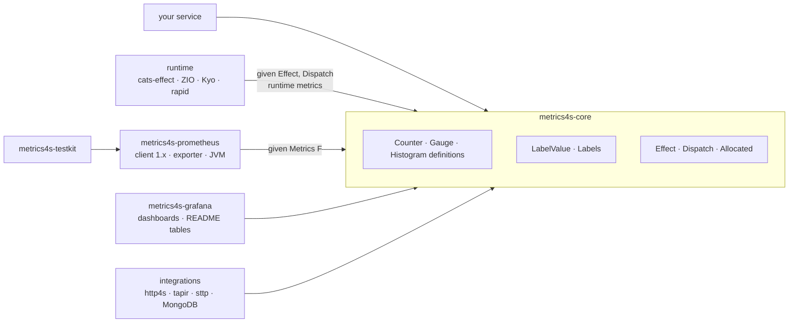

<p align="center">
  <picture>
    <source media="(prefers-color-scheme: dark)" srcset="logos/metrics4s-dark.svg">
    
  </picture>
</p>

# metrics4s

Typed, effect-agnostic metrics for `Scala 3` on the native Prometheus Java client 1.x. No hardcoded `cats-effect`, `ZIO`
or `Kyo`: the runtime (`cats-effect` / `ZIO` / `Kyo` / `rapid`) and the backend are modules wired in through a `given`,
and `core` depends on nothing.

[](https://github.com/sendline-now/metrics4s/actions/workflows/ci.yml)
[](https://central.sonatype.com/search?q=g:now.sendline%20metrics4s)
[](https://oss.sendline.now/metrics4s/)
[](https://www.scala-lang.org/)
[](https://www.apache.org/licenses/LICENSE-2.0)

The conventions a metrics guide asks people to remember are what the constructors do:

- **Names are checked where they are written.** A counter named `_total` or a duration histogram that does not end in
  `_seconds` is a compile error.
- **A unit is a type.** `Histogram.seconds` records a `FiniteDuration` and nothing else.
- **Histograms are classic.**
- **Labels come from closed sets.**
- **Series exist from the start.** Every series of an enumerated domain is created at zero when the metric is
  registered.
- **One definition, several uses.** A metric definition is a plain value, and the Grafana dashboard, the README table
  and the test all read the same one.



* [Quick start](#quick-start)
* [Running it in a service](#running-it-in-a-service)
* [Defining metrics](#defining-metrics)
* [Recording](#recording)
* [Reading at scrape time](#reading-at-scrape-time)
* [Runtimes](#runtimes)
* [The Prometheus backend](#the-prometheus-backend)
* [Testing](#testing)
* [Dashboards](#dashboards)
* [Integrations](#integrations)
* [Modules](#modules)
* [Known gaps](#known-gaps)
* [Contributing](#contributing)
* [Recipes](RECIPES.md), [Design notes](DESIGN.md), [Roadmap](ROADMAP.md), [Changelog](CHANGELOG.md),
  [Compatibility](COMPATIBILITY.md), [Benchmarks](BENCHMARKS.md)

## Quick start

Runs on JDK 17 or newer. `metrics4s-rapid` needs 21 and `metrics4s-kyo` needs 25, like the libraries they wrap.

```scala
libraryDependencies ++= Seq(
  "now.sendline" %% "metrics4s-cats"       % "0.2.0", // core + cats-effect, with its runtime metrics
  "now.sendline" %% "metrics4s-prometheus" % "0.2.0", // the backend, the exporter and JVM metrics
  "now.sendline" %% "metrics4s-grafana"    % "0.2.0", // dashboards and README tables from the definitions
  "now.sendline" %% "metrics4s-testkit"    % "0.2.0" % Test,
)
```

```scala
import scala.concurrent.duration.FiniteDuration

import cats.effect.{IO, IOApp, Resource}
import io.prometheus.metrics.model.registry.PrometheusRegistry

import metrics4s.*
import metrics4s.prometheus.{PrometheusExporter, PrometheusMetrics}
import metrics4s.runtime.cats.CatsRuntimeMetrics

import metrics4s.runtime.cats.CatsInstances.given
import metrics4s.runtime.cats.syntax.given

enum Outcome derives LabelValue:
  case Ok, Skipped, Error

object Outcome:
  given Labels[Outcome] = Labels.single("outcome")

object ProcessorMetrics:
  val processed   = Counter("processor_items", "Processed items by outcome").labelled[Outcome]
  val processTime = Histogram.seconds("processor_process_seconds", "Processing of one item", Buckets.Normal)
  val cacheSize   = Gauge("processor_cache_entries", "Entries in the cache")

final class Processor(
    processed: CounterOf[IO, Long, Outcome],
    processTime: HistogramOf[IO, FiniteDuration, NoLabels],
):
  def handle(item: String): IO[Unit] =
    processTime.timed(IO.println(item)) >> processed.inc(Outcome.Ok)

object Main extends IOApp.Simple:
  def run: IO[Unit] =
    val registry = PrometheusRegistry()
    given Metrics[IO] = PrometheusMetrics[IO](registry)

    val processor =
      for
        _                                   <- PrometheusExporter.allocated[IO](9090, registry).toResource
        _                                   <- Resource.eval(PrometheusMetrics.jvm[IO](registry))
        _                                   <- CatsRuntimeMetrics.resource[IO]()
        (processed, processTime, cacheSize) <- Resource.eval(
                                                 Metrics[IO].registerAll((ProcessorMetrics.processed, ProcessorMetrics.processTime, ProcessorMetrics.cacheSize))
                                               )
        _                                   <- Resource.eval(cacheSize.set(0))
      yield Processor(processed, processTime)

    processor.use(_.handle("first item"))
```

`http://localhost:9090/metrics` now serves `processor_items_total{outcome="ok"}`, `{outcome="skipped"}` and
`{outcome="error"}` from the first scrape (the last two at zero), the classic `processor_process_seconds_bucket`
series, the cats-effect runtime and the JVM.

Swap `metrics4s-cats` for `metrics4s-zio`, `-kyo` or `-rapid` and the matching `*Instances.given` import to change
runtime. The definitions and the calls stay the same. [RECIPES.md](RECIPES.md) has a ZIO service, labels known only at
startup, errors as a label, a dashboard kept in the repository and alerting stats.

## Running it in a service

Three things the compiler cannot check:

- **Give every copy of the app its own registry.** `PrometheusRegistry.defaultRegistry` is global to the JVM, so when
  a test run starts the app twice, the second copy finds its names taken and fails to register. Create a
  `PrometheusRegistry()` and hand the same one to the exporter.
- **Serve the metrics on a port of their own.** `PrometheusExporter.allocated(9464, registry)` listens apart from the
  API, so `/metrics` never goes out through the public ingress. A port that is taken fails with an `ExporterException`
  that names it.
- **Label only from closed sets:** an enum, a list known at startup (`LabelValue.enumerated`), or
  `LabelValue.bounded` for a value the deployment fixes, such as the build's version in an `Info`. A user id, a path
  or an error message adds a series for every value it ever takes.

## Defining metrics

A definition is a value with no effect and no registry. It is checked when it is written:

| Constructor | Name must | Records | Exposed as |
| --- | --- | --- | --- |
| `Counter` | not end with `_total`, `_seconds`, `_bytes` | `Long` | `<name>_total` |
| `Counter.seconds`, `Counter.bytes` | end with the unit | `FiniteDuration`, `Long` | `<name>_total` |
| `Gauge` | not end with `_seconds`, `_bytes` | `Double` | `<name>` |
| `Gauge.seconds`, `Gauge.bytes` | end with the unit | `FiniteDuration`, `Long` | `<name>` |
| `Histogram.seconds`, `Histogram.bytes` | end with the unit | `FiniteDuration`, `Long` | `_bucket`, `_sum`, `_count` |
| `Histogram.sizes` | not end with `_seconds`, `_bytes` | `Long` | `_bucket`, `_sum`, `_count` |
| `Info` | not end with `_seconds`, `_bytes` | its labels | `<name>_info`, always `1` |

On top of that, every name is snake case with no `__`, help is never empty, and none of the suffixes the exposition
adds (`_bucket`, `_count`, `_sum`, `_created`, `_info`, `_total`) can be written by hand. The compiler says why:

```
Invalid metric name "processor_items_total": it must not end with _total: every counter is exposed with _total added
```

**Buckets** are checked the same way (`Buckets(0.1, 0.5, 1)`: positive, strictly increasing). Computed ones go through
`Buckets.from(seq): Either[MetricError, Buckets]`. `Buckets.Fast`, `Buckets.Normal` and `Buckets.Sizes` are the sets the
services already use. Every histogram is registered `classicOnly`.

### Labels

Labels are added with `.labelled[L]`. They always come from a closed set:

```scala
enum Source derives LabelValue:
  case Kafka, Rabbit

final case class ByOutcome(outcome: Outcome, source: Source) derives Labels

val bySource = Counter("processor_source_items", "Items by outcome and source").labelled[ByOutcome]
val skipped  = Counter("processor_skipped", "Skipped items by reason").labelled[(reason: SkipReason)]
```

* **`derives LabelValue`** works for an enum whose cases take no parameters. The value is the case name in snake case:
  `NotFound` becomes `not_found`. An enum that carries its own string says so instead:
  `given LabelValue[Level] = LabelValue.enumerated(Level.values)(_.value)`.
* **`derives Labels`** works for case classes, and named tuples need nothing at all. Label names are the field names
  in snake case.
* **A single label** needs its name: `given Labels[Outcome] = Labels.single("outcome")`. A label name is never guessed
  from a type name.
* **A value bounded by its type but not enumerable**, such as a provider configured at startup, is
  `LabelValue.bounded(render)`. Its series appear as they are used.
* **There is no `LabelValue[String]`.** An id, a path or an error message would be a new series forever.

When every label is enumerated, registration creates every combination at zero. A product larger than
`MetricsConfig.preCreateLimit` (512 by default) fails registration with `MetricError.DomainTooLarge`, unless the
definition says `.withoutPreCreation`. Registration also refuses reserved label names (`le`, `quantile`, `__*`), a
label declared twice and two values that render the same.

## Recording

`Metrics[F].register(definition)` gives an instrument, and `registerAll` gives a tuple of them. If one registration in
the tuple fails, the ones already done are unregistered. Failures are a `MetricException` carrying a `MetricError`,
raised in `F`.

```scala
counter.inc(Outcome.Ok)                    // F[Unit]
counter.add(Outcome.Skipped, 5)
total.inc()                                // a metric without labels
gauge.set(Outcome.Ok, 42)
inFlight.inc(Outcome.Ok); inFlight.dec(Outcome.Ok)
gauge.replace(Map(Outcome.Ok -> 3))        // the rest goes to 0, or is removed when the label is bounded
histogram.observe(Outcome.Ok, 250.millis)
histogram.timed(Outcome.Ok)(fa)            // a success and a failure are recorded, a cancellation is not
histogram.timedBy(fa)(result => if result.isRight then Outcome.Ok else Outcome.Error)
counter.unsafe.inc(Outcome.Ok)             // Unit, for code outside F: driver listeners, interceptors
counter.unregister
```

`registerAs` registers a named tuple of definitions into a case class, so the instruments travel by name, not by
position. Each name must be a field of the class, in its order, and each field must have the type of the instrument
its definition registers as. Anything else does not compile:

```scala
final case class Processing(processed: CounterOf[IO, Long, Outcome], processTime: HistogramOf[IO, FiniteDuration, NoLabels])

Metrics[IO].registerAs[Processing]((processed = ProcessorMetrics.processed, processTime = ProcessorMetrics.processTime))
```

`Measured` times an operation and counts it by outcome in one call, the RED pattern. The histogram carries the
operation's labels, the counter carries those labels and the outcome, and the last argument builds the counter's
labels from both:

```scala
val fetch = Measured(fetchTime, fetches, FetchOutcome.Failed)((labels, outcome) => (source = labels.source, outcome = outcome))

fetch.measure((source = Source.Kafka))(repository.find(id))(found => if found.isDefined then FetchOutcome.Found else FetchOutcome.Missing)
```

The outcome of a value comes from the function. An error is counted as `Failed` and re-raised as it was, the same
instance, so the metric cannot turn a failure into a value. A cancellation records nothing. If the recording itself
fails while the operation failed, the operation's error is still the one raised, with the other suppressed in it.

An **info** carries facts rather than a number: the build's version, the stage, a configuration. Its series is always
`1`, and its labels are what the dashboard shows. `set` replaces the previous labels, so a copy shows one series:

```scala
val build = Info("processor_build", "The build that runs").labelled[(version: Version, stage: Stage)]

Metrics[IO].register(build).flatMap(_.set((version = Version(BuildInfo.version), stage = Stage.Prod)))
```

A version is not enumerable, so it is `LabelValue.bounded`. `Stat.info(build)(_.version)` shows it on a dashboard.

For an enumerated label an update is an array read: faster than the raw client, see [BENCHMARKS.md](BENCHMARKS.md).

## Reading at scrape time

Some values are cheaper to read when Prometheus asks for them. Each of these gives an `Allocated[F, Unit]`, which the
runtime turns into its own resource (see [Runtimes](#runtimes)):

```scala
Metrics[IO].observe(cacheSize)(_.report(cache.size.toDouble))

Metrics[IO].observeAll(scheduler.status())(                  // one read per scrape, several metrics
  Observation(workers)((status, out) => out.report(status.workers.toDouble)),
  Observation(load)((status, out) => out.report(status.load)),
)

Metrics[IO].observeAllF(queue.size, timeout = 1.second)(      // a value only available in F
  Observation(queueSize)((size, out) => out.report(size.toDouble))
)
```

A callback that throws, or an `F` that runs past its timeout, does not break the scrape. Its metrics are left out of
that scrape, the `F` is cancelled, and `metrics4s_callback_errors_total{metric="<first metric>"}` counts it.

## Runtimes

| Runtime | Instances | Native resource | Runtime metrics |
| --- | --- | --- | --- |
| cats-effect | `metrics4s.runtime.cats.CatsInstances.given` (`Sync` for `Effect`, `Async` for `Dispatch`) | `allocated.toResource` | `CatsRuntimeMetrics.resource()` |
| ZIO | `metrics4s.runtime.zio.ZioInstances.given` (`Task`) | `allocated.toScoped` | `ZioRuntimeMetrics.scoped` |
| Kyo | `metrics4s.runtime.kyo.KyoInstances.given` (`KIO`) | `allocated.toScope` | `KyoRuntimeMetrics.scoped` |
| rapid | `metrics4s.runtime.rapid.RapidInstances.given` (`Task`) | `allocated.use(f)` | none (rapid exposes no scheduler state) |

The adapters come from `metrics4s.runtime.<runtime>.syntax.given`. The four `Effect` instances pass one shared
`EffectSuite`: exit cases, finalizer errors, brackets, resources, and a `Dispatch` that times out and cancels what it
gave up on.

The runtime metrics export the families commons exports, with the same names, types and labels:

- **cats-effect:**
  - `cats_effect_compute_threads*` and `cats_effect_fibers{state}`;
  - per-worker `cats_effect_worker_*{worker}` and `cats_effect_timers_*{worker}`;
  - `cats_effect_cpu_starvation_total`;
  - `cats_effect_cpu_starvation_clock_drift_seconds`, sampled by a fiber with the interval of the starvation check.
- **ZIO:**
  - `zio_executor_*{executor}` for the default and the blocking executor;
  - `zio_fibers{state}`, `zio_fibers_started_total` and `zio_fibers_ended_total{outcome}`, counted through a
    `Supervisor`.
- **Kyo:**
  - `kyo_scheduler_*` and per-worker `kyo_worker_*{worker}`;
  - all read from one `Scheduler.status()` per scrape.

## The Prometheus backend

```scala
given Metrics[IO] = PrometheusMetrics[IO](registry)              // or PrometheusMetrics[IO](registry, MetricsConfig.default.withPreCreateLimit(1024))
PrometheusMetrics.jvm[IO](registry)                              // the client's own JVM metrics: jvm_memory_used_bytes, process_cpu_seconds_total, ...
PrometheusExporter.allocated[IO](9090, registry).toResource      // HTTPServer; port 0 picks a free one, exporter.port says which
PrometheusScrape.text(registry)                                  // the exposition, for a /metrics route of your own
```

The registry is passed, never assumed. `PrometheusRegistry.defaultRegistry` is the one other Java libraries register
on, so services often want it. When they do, they write it out.

When the exporter cannot listen on its port, `allocated` fails with an `ExporterException`: its message and its `port`
name the port, and the bind failure is its cause.

## Testing

Tests read real values from a real registry:

```scala
val testkit = MetricsTestkit()
given Metrics[IO] = testkit.metrics[IO]

for
  counter <- Metrics[IO].register(ProcessorMetrics.processed)
  _       <- counter.inc(Outcome.Ok)
yield
  testkit.value(ProcessorMetrics.processed, Outcome.Ok) shouldBe Some(1.0)
  testkit.value(ProcessorMetrics.processed, Outcome.Error) shouldBe Some(0.0)
```

* `value`, `histogram(...)` (`count`, `sum`, cumulative `buckets`) and `labelValues` take the definition, so a test
  cannot misspell a series.
* `series` is the exposition as a map, keyed `name{a="x",b="y"}` the way the dashboards read it.
* `missingSeries(dashboard)` lists every series a dashboard queries that the registry does not export.

## Dashboards

`metrics4s-grafana` builds the dashboard JSON from the definitions:

```scala
val dashboard = Dashboard("processor", "Line / processor", "line", ServiceFilter.regex("([a-z]+-)?processor.*"))(
  Stats(Stat.podsUp, Stat.rate(ProcessorMetrics.processed), Stat.p95(ProcessorMetrics.processTime)),
  Row("Processing")(
    Panel.rate(ProcessorMetrics.processed).byAll,
    Panel.latency(ProcessorMetrics.processTime),
    Panel.gauge(ProcessorMetrics.cacheSize, Pods.Max),
  ),
  Rows.catsEffect,
  Rows.jvm,
)

dashboard.render     // Either[GrafanaError, String]
dashboard.writeTo(Paths.get("metrics"))
```

* The generator applies the guide's rules itself:
  - no `__inputs`, and a `datasource` variable;
  - `namespace`, `service` and `pod` variables read from `up`, and every query filtered by all three;
  - `$__rate_interval` everywhere, and `sum by (le)` in every quantile;
  - the unit taken from the definition;
  - a fixed `uid`, unique ids, and a 24-wide grid with nothing overlapping;
  - the group tag and links.
  A custom query that breaks one of these rules fails `render`.
* `.by(_.outcome)` groups by a label field and does not compile for a field that does not exist. `.byAll` groups by
  every label, and `.byLabel("outcome")` takes the name as a string.
* `.where(_.outcome =!= Outcome.Ok)` keeps the series whose label matches. The values are rendered through the label's
  own `LabelValue`, so a renamed case cannot silently match nothing. `===`, `=!=`, `.in(a, b)` and `.notIn(a, b)`
  compare one label field with values of its type, and anything else does not compile. Stats take the same filters:
  `Stat.rate(processed).where(_.source === Source.Kafka)` is the rate of one source.
* `Panel.quantile(histogram, 0.95)` draws one quantile, by any labels, where `Panel.latency` draws p50, p95 and p99.
  `Stat.quantile(histogram, 0.95)` is the stat, and `Stat.p95` its shorthand.
* `Panel.share(counter)(_.result === CacheResult.Hit)` and `Stat.share(counter)(...)` draw the share of the counter's
  rate that matches, in `percentunit`.
* `.withThresholds(Color.Green, 0.01 -> Color.Orange, 0.05 -> Color.Red)` colours a stat by its value: green below
  1%, orange from 1%, red from 5%. The values must be finite and increasing, or `render` fails. A stat is green
  otherwise, and `Stat.podsUp` is red below one pod.
* `dashboard.missingSeries(definitions)` lists the series the dashboard's own panels and stats read that none of the
  definitions serves, such as a panel left behind by a renamed metric. One line in a test gives every service the
  check. The shared rows are left out: the library checks them against its own definitions.
* `Rows.catsEffect`, `Rows.zio`, `Rows.kyo`, `Rows.jvm`, `Rows.httpServer`, `Rows.httpClient` and `Rows.mongo` are the
  shared rows. The cats-effect and JVM rows query exactly what the hand-written merger and descriptions dashboards
  query.
* Keep the rendered JSON in the repository and compare it in a test, so a metric changed without its dashboard fails
  the build.
* `MetricsDoc.markdown(definitions*)` writes the `Metric | Type | Labels | What` table for `metrics/README.md`, with the
  label values listed.

The integration tests import a generated dashboard into Grafana 12. Every query of every panel then has to return
data through Grafana's Prometheus datasource, scraped by Prometheus 3.5 from a running service.

## Integrations

All four share the HTTP definitions in `metrics4s-http`, so one dashboard row fits whichever is used. Routes are
templates from a closed set, and status is a class (`2xx`, `4xx`, `failed`).

```scala
// http4s: the route templates and a classifier into them; anything else is "unmatched"
val middleware = Http4sServerMetrics[IO](List("GET /events/{id}", "POST /events"))(classify)
val client     = Http4sClientMetrics[IO](httpClient, List("get-event"))(operationOf)

// tapir: the templates come from the endpoints
TapirMetrics[IO](endpoints).map(metrics => Http4sServerOptions.customiseInterceptors[IO].metricsInterceptor(metrics.interceptor))

// sttp client 4
SttpMetrics.register[IO](List("get-user")).map(recorder => SttpMetrics.wrap(backend, recorder)(operationOf))

// MongoDB driver, and mongo4s through MongoClientResource.fromSettings
MongoMetrics(List("users", "events")).register[IO].map(listeners => listeners.applyTo(MongoClientSettings.builder()).build())
```

The same definitions are on the companions, with no routes or collections: `HttpServerMetrics.requests`, `.duration`
and `.inFlight`, the same three on `HttpClientMetrics`, the five of `MongoMetrics`, and `definitions` on each. A
dashboard needs the label names, not the values, so it draws from them without the service's route list:

```scala
Stats(
  Stat.rate(HttpServerMetrics.requests),
  Stat.quantile(HttpServerMetrics.duration, 0.95),
  Stat.share(HttpServerMetrics.requests)(_.status.in(StatusClass.ServerError, StatusClass.Failed)),
)

dashboard.missingSeries(List(ProcessorMetrics.processed, ProcessorMetrics.processTime) ++ HttpServerMetrics.definitions)
```

| Module | Metrics |
| --- | --- |
| `metrics4s-http4s`, `metrics4s-tapir` | `http_server_requests_total{route, status}`, `http_server_request_seconds{route}`, `http_server_in_flight` |
| `metrics4s-http4s`, `metrics4s-sttp` | `http_client_requests_total{operation, status}`, `http_client_request_seconds{operation}`, `http_client_in_flight` |
| `metrics4s-mongo` | `mongo_command_seconds{command, collection}`, `mongo_command_failures_total{command, collection}`, `mongo_pool_connections{state}`, `mongo_pool_checkout_seconds`, `mongo_pool_checkout_failures_total{reason}` |

## Modules

| Module | Depends on | What |
| --- | --- | --- |
| `metrics4s-core` | nothing | Definitions, labels, instruments, callbacks, `Effect`/`Dispatch`/`Allocated`, the backend SPI |
| `metrics4s-prometheus` | core, Prometheus client 1.10 | The backend, the exporter, JVM metrics |
| `metrics4s-cats`, `-zio`, `-kyo`, `-rapid` | core, the runtime | Instances, resource adapters, runtime metrics |
| `metrics4s-testkit` | prometheus, grafana | A registry per test, typed reads, dashboard coverage |
| `metrics4s-grafana` | core | Dashboards and README tables |
| `metrics4s-http` | core | The HTTP definitions the HTTP integrations share |
| `metrics4s-http4s` | http, cats, http4s 0.23 | Server and client middleware |
| `metrics4s-tapir` | http, tapir-server | A metric for `MetricsRequestInterceptor` |
| `metrics4s-sttp` | http, sttp client 4 | A listener backend |
| `metrics4s-mongo` | core, mongodb-driver-core | Command and connection-pool listeners |

## Known gaps

- `process_resident_memory_bytes` is read from `/proc`, so it exists only on Linux. On macOS that JVM panel is empty.
- MongoDB command series are not created up front: commands times collections times buckets would be thousands of
  zeros. Their panels fill as the commands run.
- rapid cancels by interrupting a thread. A fiber cancelled while parked on a callback runs none of its finalizers.
- Kyo does not wait for a cancelled fiber's finalizers, so they may finish after the cancellation returns.
- ZIO fiber metrics count only the fibers started after the metrics are registered.
- cats-effect 3.7.1 counts a timer that fires on its own thread twice in `_executed`, and `_canceled` lags behind.
- `metrics4s_callback_errors_total` is read in the same scrape as the callbacks it counts, so a scrape shows the
  failures up to the one before it.

## Contributing

How to build, test and release the project is in [CONTRIBUTING.md](CONTRIBUTING.md); security reports go through
[SECURITY.md](SECURITY.md), and the [code of conduct](CODE_OF_CONDUCT.md) applies everywhere.

## License

Apache 2.0, see [LICENSE](LICENSE).
